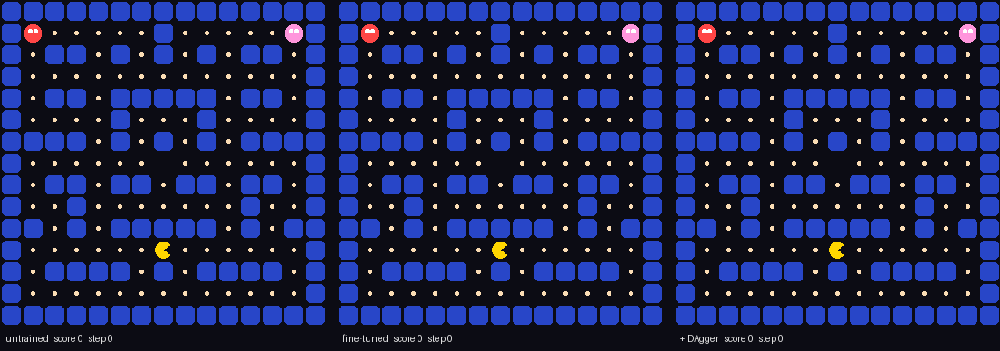

# Fine-tuning Laya on a 6 GB GPU

A practical guide to fine-tuning [Laya](https://github.com/NandhaKishorM/laya), the open-source
(Apache 2.0) decision model, for your own decisions, plus two worked examples. Everything
here ran on a desktop RTX 3050 with 6 GB of memory, then again on a Mac mini with an M4 Pro.
No cloud GPU.



| | untrained Laya | fine-tuned Laya | the reference |
| --- | --- | --- | --- |
| [Pac-Man](pacman/), games won of 200 | 0 | **87** after one DAgger round (M4 Pro: 77) | its teacher: 78 |
| [Pigeonhole](pigeonhole/), tests passed of 50 | 31 | **44**, ties Cloudflare's Clef (M4 Pro: 42) | Jev: 47 |
| time per decision | ~100 ms | ~100 ms | Jev: ~500 ms |

Full numbers, costs and timings are in [`RESULTS.md`](RESULTS.md). The story behind them is
on [bnap.dev](https://bnap.dev/blog/fine-tuning-laya-on-a-6gb-gpu).

- [The idea](#the-idea)
- [Step 0: set up](#step-0-set-up)
- [Step 1: shape the decision](#step-1-shape-the-decision)
- [Step 2: get inputs](#step-2-get-inputs)
- [Step 3: get a teacher](#step-3-get-a-teacher)
- [Step 4: write the training file](#step-4-write-the-training-file)
- [Step 5: train](#step-5-train)
- [Step 6: test it on something it has never seen](#step-6-test-it-on-something-it-has-never-seen)
- [Step 7: use it](#step-7-use-it)
- [Step 8 (optional): let it learn from its own mistakes](#step-8-optional-let-it-learn-from-its-own-mistakes)
- [Things that went wrong for me](#things-that-went-wrong-for-me)
- [The worked examples](#the-worked-examples)

## The idea

Laya answers typed questions about a piece of text in one forward pass: a `choice` between
named options, a `score` on an ordered scale, or a `noul` (the probability of yes). Out of the
box it knows nothing about your job. On my classifiers it got 31 of 50 test cases right; at
Pac-Man it played no better than random.

Fine-tuning teaches it from a **teacher**: anything that's better at the decision than Laya,
but too slow, too expensive or too far away to use everywhere. You show Laya thousands of
inputs with the teacher's *probabilities* over every option, and it learns to copy them. Then
it runs locally, in ~100 ms, for free.

Every fine-tune is the same loop:

1. Get inputs like the ones the model will see.
2. Ask a teacher for its probabilities on each one.
3. Train Laya to match them.
4. Test on inputs it has never seen.

## Step 0: set up

You need Python 3.10+ and, realistically, either an NVIDIA GPU with 6 GB or more or an Apple
Silicon Mac with 16 GB or more of memory ([macOS notes below](#on-a-mac)). Training on a CPU
works but is very slow.

```bash
git clone https://github.com/bnap00/laya-fine-tuning && cd laya-fine-tuning
uv venv --python 3.12 .venv
uv pip install --python .venv/bin/python -r requirements.txt
.venv/bin/python -c "import torch; print(torch.__version__, torch.cuda.is_available())"
```

If that prints `False` on a machine with an NVIDIA card, PyTorch was built for a newer CUDA than
your driver supports. Nothing crashes; everything quietly runs on the CPU. Check the CUDA
version `nvidia-smi` reports and install a matching build:

```bash
uv pip install --python .venv/bin/python torch --torch-backend=cu126   # driver supports CUDA 12.x
```

### On a Mac

The same three install commands work on Apple Silicon; the stock PyTorch wheel includes the
Metal (MPS) backend. Check for it instead of CUDA:

```bash
.venv/bin/python -c "import torch; print(torch.__version__, torch.backends.mps.is_available())"
```

`finetune.py` picks MPS automatically (`--device auto`), and the training log says
`device mps`. Nothing else changes: same commands, same flags, same checkpoint format.

Two things differ from an NVIDIA card:

- **Memory.** Laya's trainer only turns on fp16 autocast and gradient checkpointing for CUDA.
  On MPS it trains in full fp32, so the same runs peaked at 8.8 GB (Pac-Man) and 13.0 GB
  (Pigeonhole, longer inputs) instead of 3.8 GB. The GPU shares the Mac's RAM, so on a 16 GB Mac
  close other apps first; 24 GB had room to spare. If it runs out, lower `--micro-batch`.
- **Speed.** An M4 Pro (16-core GPU, 24 GB) trains about 10% faster than the RTX 3050:
  25.6 minutes instead of 28 for Pigeonhole, 37 instead of 41 for Pac-Man. Single decisions
  are a little slower (~52-54 ms a Pac-Man move against ~43 ms), because a batch of one
  doesn't fill the GPU.
- **Results.** Same data, same flags, slightly different numerics (fp32 against fp16), so
  the checkpoints aren't identical. The Mac runs scored 42/50 on Pigeonhole (3050: 44) and
  77/200 Pac-Man wins after DAgger (3050: 87; the teacher wins 78). Both are within the
  run-to-run noise of these tests.

Full Mac numbers are in [`RESULTS.md`](RESULTS.md#apple-m4-pro).

## Step 1: shape the decision

Write the decision as one or more Laya questions. If it isn't a choice, a scale or a yes/no,
reshape it until it is.

```python
questions = {
    "department": {"type": "choice", "instructions": "Which team should handle this ticket?",
                   "criteria": {"billing": "charges, invoices, refunds not yet received",
                                "shipping": "where an order is, delays, address changes",
                                "returns": "exchanges, wrong or damaged items"}},
    "urgency":    {"type": "score", "instructions": "How urgently does this need a reply?",
                   "criteria": ["can wait a day", "today", "now"]},
    "angry":      {"type": "noul", "instructions": "The customer is angry or threatening to leave."},
}
```

Two rules that matter more than they look:

- **Keep option descriptions short.** Laya fits every option into a small token budget
  (192 tokens by default for the English checkpoint). Paragraph-long descriptions get cut off.
- **Freeze the wording before you train.** The fine-tuned model learns *this* text. If your app
  renders the question differently at inference (different option text, a flattened format),
  train on the rendered version. The Pigeonhole example trains on exactly the one-line form
  Pigeonhole sends.

The options don't have to be fixed. In the Pac-Man example the options are the legal moves
in that position, each described in words: `"left": "eats a pellet, closest ghost 9 steps away"`.

## Step 2: get inputs

You want a few thousand realistic inputs. Where they come from depends on what you have:

| you have | do this |
| --- | --- |
| production logs | sample them; that's the best data there is |
| nothing yet | have a cheap chat model write them from the classifier's description, in many styles ([`pigeonhole/generate.py`](pigeonhole/generate.py): 1,971 inputs for ~$0.10) |
| a simulator or game | play it and save every state ([`pacman/make_dataset.py`](pacman/make_dataset.py)) |

Whatever the source, **keep your test cases out of it.** Don't show them to the generator, and
drop anything that's a near-copy of one. `generate.py` does both.

How many? Laya's trainer prints the number of optimizer updates a run will make, and that's the
number to watch. Its docs report a run that collapsed at 72 updates; my runs used 597 to 764.
If your dataset is small, add epochs until you're in the hundreds.

## Step 3: get a teacher

The teacher writes the targets. Probabilities beat hard labels: "billing 0.91, returns 0.06"
teaches Laya how sure to be, and Laya's trainer (RLCD) is built around copying a distribution.

| teacher | cost | used in |
| --- | --- | --- |
| a hosted decision model (Jev, Clef, GPT-6 Luna) | per call, tiny | [`pigeonhole/label.py`](pigeonhole/label.py): Jev, $0.07 for 1,971 inputs |
| your Claude Code or Codex subscription, writing and labelling in one pass | your plan's usage | [`pigeonhole/teach.py`](pigeonhole/teach.py): see [RESULTS.md](RESULTS.md#agent-teachers) |
| code that already makes the decision (rules, search, an expert system) | free | [`pacman/agents.py`](pacman/agents.py): 20 lines of distance arithmetic |
| people (reviewed tickets, moderation decisions) | already paid for | use hard labels (`expected`) |

The teacher is the ceiling. Fine-tuned Laya got close to Jev on my classifiers, never past it.

## Step 4: write the training file

Two formats. Use JSONL if you have probabilities or more than one question per input:

```json
{"state": {"body": "I was charged twice for order 4412."},
 "questions": {"department": {"type": "choice", "instructions": "Which team should handle this ticket?",
                              "criteria": {"billing": "...", "shipping": "...", "returns": "..."}},
               "angry": {"type": "noul", "instructions": "The customer is angry or threatening to leave."}},
 "gold": {"department": {"probabilities": {"billing": 0.91, "returns": 0.06, "shipping": 0.03}},
          "angry": {"probabilities": {"false": 0.8, "true": 0.2}}}}
```

- `state` can be a string or a JSON object.
- `gold` holds the teacher's probabilities. `noul` is keyed `"false"`/`"true"`; `score` is keyed
  by the level index as a string (`"0"`, `"1"`, ...).
- Hard labels work too: `"expected": {"department": "billing", "angry": false}`.
- Questions can differ per row (the Pac-Man options change every move).

Or a CSV, if each row is one text and one label:

```csv
body,team
"I was charged twice for March",billing
"The app crashes when I open settings",technical
```

## Step 5: train

[`finetune.py`](finetune.py) wraps `laya.train.finetune`. It trains Laya's decision head and
the top N encoder layers, fits calibration temperatures on a slice it held out from training,
and saves a checkpoint `laya.load` opens.

```bash
# JSONL
.venv/bin/python finetune.py data/train.jsonl checkpoints/mine --epochs 3

# CSV
.venv/bin/python finetune.py tickets.csv checkpoints/tickets --text-column body --label-column team \
    --question-id team --instructions "Which team should handle this ticket?"
```

### Why only the top layers

A full fine-tune of the 421M English checkpoint needs about 7 GB for the weights, gradients and
optimizer state alone. That doesn't fit on a 6 GB card. Laya's `--freeze-encoder` trains only
the head, which fits but, per its docs, "gains much less than a full fine-tune".

`finetune.py` freezes the embeddings and the bottom 22 of 28 encoder layers, and trains the top
6 plus the head: 100M of 421M parameters, peaking at about 3.8 GB. Laya's trainer already skips
frozen parameters, so this is a wrapper, not a fork.

| flag | default | |
| --- | --- | --- |
| `--base` | `english` | `english`, `multilingual`, `typed-decisions`, a Hub id or a checkpoint directory (continue training a fine-tune) |
| `--top-layers` | `6` | encoder layers to train; `-1` trains everything (needs a bigger card) |
| `--epochs` | `3` | |
| `--micro-batch`, `--grad-accum` | `8`, `4` | effective batch 32; lower `--micro-batch` if you run out of memory |
| `--loss` | `rlcd` | Laya's proper-scoring-rule objective, or `soft-ce` |
| `--eval-data` | | a held-out JSONL, scored before and after training |
| `--shuffle-options` | off | re-orders choice options every epoch; Laya's docs recommend it for questions with many options |
| `--device` | `auto` | `cuda`, `mps` or `cpu` |
| `--text-column`, `--label-column`, `--question-id`, `--instructions` | | CSV input |

On the RTX 3050 a run processes about 10 question-items a second: 28 minutes for 6,358 items
× 3 epochs, 41 minutes for 12,195 × 2. An M4 Pro does the same runs in 25.6 and 37 minutes.
Anything else using the GPU (another model server, a desktop compositor, on a Mac any app)
eats into its memory, so stop it while training.

### Read the report

At the end, the trainer prints a before/after table on the calibration slice (or on
`--eval-data` if you gave it one). From the Pac-Man run:

```text
Metric                 Before         After
Accuracy               0.6216         0.8996
ECE                    0.1342         0.0414
```

Accuracy is agreement with the teacher's top choice. ECE is calibration error: how far its
stated confidence is from how often it's right. You want accuracy up and ECE down. If accuracy doesn't move off chance, Laya's docs suggest a positive control: add a tag
that spells the answer (`label=billing; `) to every input and train again. If it can't learn
*that*, the problem is the run, not your task.

## Step 6: test it on something it has never seen

The calibration slice is a sanity check, not a score. Score the checkpoint on inputs that were
never near training:

- **Classifiers:** a hand-written test set. [`pigeonhole/harness.py`](pigeonhole/harness.py)
  scores any model on Pigeonhole's template tests, the same way Pigeonhole does.
- **Games and simulators:** fresh seeds. [`pacman/play.py`](pacman/play.py) plays 200 games on
  seeds no training game used.

Run more than you think you need. After 50 games my fine-tuned model had won 20 and its teacher
16. Over 200 games the teacher won 39% and the student 31.5%.

## Step 7: use it

The checkpoint loads like any other Laya model. Ask it the same questions you trained on:

```python
import laya

agent = laya.load("checkpoints/mine")
answers = agent.predict(state, questions)["answers"]
print(answers["department"]["choice"], answers["department"]["probabilities"])
```

For a CSV run, the question is saved beside the checkpoint:
`questions = json.load(open("checkpoints/tickets/questions.json"))`.

To serve it over HTTP (Laya's Jev-compatible `POST /v1/systemone`), register it with
`laya-serve` and pass `"model": "mine"` in requests:

```bash
pip install "laya[serve]"
LAYA_EXTRA_MODELS='{"mine": "/path/to/checkpoints/mine"}' laya-serve
```

## Step 8 (optional): let it learn from its own mistakes

A student trained only on the teacher's data has never seen the situations its own mistakes
lead to. **DAgger** fixes that: let the fine-tuned model act, have the teacher label every
state it ends up in, and train again starting from the fine-tuned checkpoint.

```bash
cd pacman
../.venv/bin/python make_dataset.py --games 150 --first-seed 200000 --explore 0.05 \
    --student ../checkpoints/pacman-v1 --out data/dagger.jsonl
# mix in some of the original data, then continue from v1
../.venv/bin/python ../finetune.py data/v2.jsonl ../checkpoints/pacman-v2 --base ../checkpoints/pacman-v1 --epochs 1
```

One round took Pac-Man from 63 to 87 wins out of 200. This needs the student to *drive*, so it
fits games, agents and anything where Laya's answer changes what it sees next. For a
classifier, the equivalent is labelling the production inputs it gets wrong.

## Things that went wrong for me

- **PyTorch built for CUDA 13 on a CUDA 12.7 driver** ran everything on the CPU without a
  warning. See [step 0](#step-0-set-up).
- **Training on stale question text.** My first Pigeonhole run used templates whose option
  descriptions had been cut off at the first comma (a YAML quoting bug, since fixed). It
  scored 41/50. Relabelled and retrained on the fixed text: 44/50.
- **Recording changed the game.** Copying the game state for a GIF consumed a number from the
  game's random generator, so recorded games played differently. Scores weren't affected, the
  GIFs were. If your evaluation has randomness, make sure observing it doesn't touch it.

## The worked examples

| | [`pacman/`](pacman/) | [`pigeonhole/`](pigeonhole/) |
| --- | --- | --- |
| decision | which way to move, every tick | five classifiers: email routing, issue labelling, lead qualification, moderation, support triage |
| inputs | 12,595 game states | 1,971 inputs written by Claude Haiku 5.5 |
| teacher | a hand-written expert, free | Jev on OpenRouter, $0.07 |
| training, RTX 3050 | 41 min + 28 min DAgger round | 28 min |
| training, M4 Pro | 37 min + 24 min DAgger round | 25.6 min |
| test | 200 games on unseen seeds | Pigeonhole's 50 template test cases |
| result, RTX 3050 | 0 → 87 wins (teacher: 78) | 31 → 44 passed (Jev: 47) |
| result, M4 Pro | 0 → 77 wins | 31 → 42 passed |

Each folder's README has the exact commands. The Pigeonhole example needs an
`OPENROUTER_API_KEY` in `.env`; Pac-Man needs nothing but the GPU.

```text
finetune.py            the training wrapper (top-N layers, calibration, checkpoint)
pacman/                game, teacher, dataset builder, scoreboard, GIFs
pigeonhole/            input generator, Jev labeller, scoring harness, templates, data
RESULTS.md             every number, with costs and timings
```

## License

Apache 2.0. The Pigeonhole templates in `pigeonhole/templates/` are copied from
[bnap00/pigeonhole](https://github.com/bnap00/pigeonhole), also Apache 2.0. Laya is by
[Convai Innovations](https://github.com/NandhaKishorM/laya), Apache 2.0.
